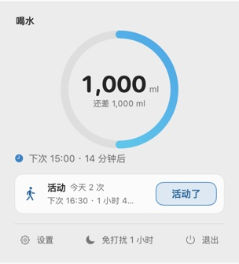
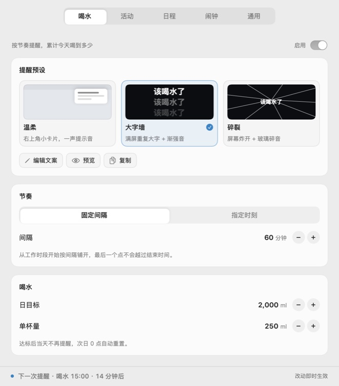
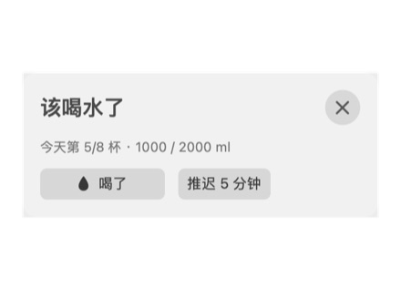

# Barge In

常驻 macOS 菜单栏的反内耗提醒：你在心流里停不下来的时候，把你从手头这件事里拽出来，免得漏掉别的正事——该喝水、该起身活动、该进下一场会、该去点外卖。这里的「内耗」只有一个意思：手头这件事把你别的正事挤掉，不是精神内耗。

零权限、零账号、零遥测。数据只在本机；日程订阅与更新检查是仅有的联网功能，都只读，更新检查可关闭。

官网：[barge-in.qiqiang.online](https://barge-in.qiqiang.online)

## 下载

[下载最新版本](https://github.com/qiqiangvae/BargeIn/releases/latest) · macOS 14+ · Apple Silicon（arm64）· 约 2 MB

解压后把 `Barge In.app` 拖进「应用程序」。构建产物是 ad-hoc 签名、未公证，首次打开被 Gatekeeper 拦下时点右键 →「打开」，或执行：

```sh
xattr -d com.apple.quarantine "/Applications/Barge In.app"
```

想自己构建见下方[构建](#构建)。

## 为什么做它

> "太温柔了。我知道我要喝水，但我就是停不下来工作。"

系统通知横幅、角标、轻轻一声"叮"——对"停不下来"的人等于零。现有提醒工具把"提醒长什么样"当成写死的功能，把"强制"藏进 JSON 开关。Barge In 的出发点是：**提醒的呈现方式就是产品**。

同一句"太温柔了"也适用于日程：日历 App 会在会前五分钟给你一条横幅，而你会把它划掉。Barge In 做的是**同一份日历，不同的打断强度**。

## 现在有什么（v0.4）

- 菜单栏常驻，无 Dock 图标、无主窗口
- **四个场景**：喝水（日目标、单杯量、今日进度、达标即静默）、活动（到点起身舒展，没有每日目标）、日程（订阅你已有的日历）、闹钟（你自己定的时刻）；四者等权，每个场景有自己的启用开关、调度、预设实例与账本
- 三种结束方式：**喝了 / 活动了 / 知道了**（或 1 秒内连按两次 Enter）/ **推迟 5 分钟** / **中断**（双击 Esc 立即生效；× 按预设，强硬档前 5 秒按钮全锁）
- **三套呈现预设**：温柔（右上角卡片 + 提示音）/ 大字墙（满屏重复大字 + 渐强音）/ 碎裂（满屏碎玻璃 + 玻璃碎音）；大字墙可选强度——标准（可推迟）/ 强硬（不可推迟、按钮先锁 5 秒），大字墙每次重新排布、碎裂每次重新生成花纹，出厂默认大字墙 · 标准，每张卡都能单独预览
- **账本按场景各一份**：记录今天的进度、完成与跳过，不改变下一次提醒的呈现，也不在界面上念叨
- **同时到点**：按提醒队列逐条呈现，关闭一条立刻下一条，提醒层显示"还有 N 个提醒"；每个场景最多一条、日程与闹钟按条各一条，不静默丢弃
- 调度：固定间隔或每天指定时刻，可设工作时段与休息日；活动出厂默认每天 10:30 / 14:30 / 16:30
- **闹钟**：每条一个时刻加一句话，重复只有两种——每天（每个非休息日）或仅一次（未来 7 天内）；和喝水、活动一样受工作时段与休息日约束，冲突的条目在设置里标成「不会响」并写明原因；一次性响过或过期就消失
- 设置分五个 tab：喝水 / 活动 / 日程 / 闹钟 / 通用；预设、节奏与启用开关按场景，工作时段、休息日、开机自启与更新收在「通用」
- **自动更新检查**：启动时与每 24 小时问一次 GitHub 有没有新版本（只读，不发送任何数据）；有新版时用「温柔」卡提醒，点卡片进「通用」，一键下载安装并重启。默认开启，可以关掉；关掉后 App 不再为更新联网，仍可在通用里手动检查
- 免打扰 1 小时、开机自启
- **人不在就不提醒**：锁屏、屏幕睡眠、切到别的用户时不采集到点，离开时连正在显示的那条也收起；回来时日程仍按「开始后 10 分钟」补，节奏类等下一个点，一次性闹钟若还在补发窗口里就补一次
- 首次启动一次预设选择同时应用到四个场景（默认大字墙 · 标准），随后立即真实预览一次

## 日程：用你已有的日历决定什么时候打断你

- 订阅你已有的日历，事件开始前 N 分钟（默认 5）把你拽出来
- 两种只读来源：**一条日历地址**（Google 秘密地址 / iCloud 公开共享 / Outlook 发布链接 / Nextcloud 公开分享），或**一套 CalDAV 凭据**（钉钉、企业微信、飞书、iCloud 私有、Fastmail、Nextcloud）
- 钉钉：日历设置 → 同步 → 同步到其他日历 → 获取 CalDAV 账号，把服务器、账号、密码填进来即可
- 只读的边界：只发读请求（`GET` / `PROPFIND` / `REPORT`），不写回、不新建、不删除、不读参会人；支持多条来源
- 日程豁免工作时段与休息日（19:00 的会、周六的日程照常提醒），免打扰仍然生效
- 两个会挨着也能各提醒一次，逐条呈现
- 拉取失败不丢提醒：按上次缓存继续提醒，并明说数据可能过期
- 出厂停用；添加订阅并成功拉取后提示开启

## 闹钟：你自己定下的时刻

- 每条闹钟一个时刻加一句话；重复只有两种——**每天**（每个非休息日）或**仅一次**（未来 7 天内的一天），不提供"选星期几"：星期只有一个来源，就是通用的休息日
- 和喝水、活动共用工作时段与休息日：时刻不在工作时段内、或一次性那天是休息日，这一条在设置里标成「不会响」并写明原因，不参与调度，也不计入账本；改一次通用时间就立即重判
- 跳过与完成都只记录，不改变呈现；一次性闹钟响过、被关闭或过了那一天就从列表消失
- 不在场不采集；一次性闹钟有 60 分钟补发窗口，并被当天工作时段结束封顶——下班之后不该再弹一条工作提醒

界面原型：[菜单栏](docs/prototypes/popover.html?preset=schederror) · [设置](docs/prototypes/settings.html?view=app) · [更新通知](docs/prototypes/update.html)。支持范围与技术方案见 [设计](docs/design.md)，联网的边界见 [ADR-0001](docs/adr/0001-network-for-calendar-subscriptions.md) 与 [ADR-0006](docs/adr/0006-update-check-network.md)，闹钟与日程为什么拆成两个场景见 [ADR-0002](docs/adr/0002-alarms-vs-calendar.md)，为什么不做自动升级见 [ADR-0003](docs/adr/0003-no-automatic-escalation.md)，发布模型见 [ADR-0004](docs/adr/0004-release-model-private-core.md)。

**关于联网**：日程订阅与更新检查是仅有的两个联网功能，都只读。日程只向你填的地址做只读请求（`GET` 取一条日历地址，`PROPFIND` / `REPORT` 取一个 CalDAV 账户）；更新检查只向 GitHub 要一次最新版本号与发布说明。两者都不上传任何内容，没有账号体系，没有遥测；关掉日程场景并删掉订阅、再关掉「自动检查更新」，就再也没有请求。

## 界面

| 菜单栏 | 设置 |
|---|---|
|  |  |

全屏提醒（标准档）：满屏重复的「该喝水了」，大小字混排、错峰闪烁。


强硬档：不能推迟，按钮先锁 5 秒——"喝了"与 × 都要等，双击 Esc 仍可立刻中断：


温柔档：右上角卡片。



活动场景共用同一套呈现资源，只换文案与完成动作：


## 构建

需要 macOS 14 与 Command Line Tools（不需要完整 Xcode）。

```sh
git clone https://github.com/qiqiangvae/BargeIn.git
cd BargeIn
make app          # 产出 "Barge In.app"（ad-hoc 签名）
open "Barge In.app"
```

开发时直接跑：

```sh
make run          # swift run
```

自检（不需要 UI）：

```sh
"./Barge In.app/Contents/MacOS/BargeIn" --selftest
```

离屏截图（`--snapshot <dir>`）会把 popover、设置和提醒层渲染成 PNG，用于开发期视觉检查；`--demo` 直接看一次提醒长什么样。

## 设计取舍

- **不劫持系统**：不拦键盘、不改系统音量、不阻止切 App。展示时短暂取得键盘焦点（双击 Esc 可中断），关闭后把前台还给原 App。强度来自预设本身，不来自"这次逃不掉"
- **预设即强度**：产品不根据跳过次数自动加码；要更狠就换预设或改强度。账本只记录，不参与呈现
- **人不在就不提醒**：提醒是给正在工作的你，不是给空桌子。锁屏、屏幕睡眠、切走用户时到点的那一拍直接作废，账本也不记你跳过；回来时日程仍按「开始后 10 分钟」补，节奏类等下一个点
- **零系统权限**：不用通知中心、不用辅助功能、不用屏幕录制、不用 Apple Events。联网不是权限，它是产品对用户的一次性例外，写在这里而不是藏在设置里
- **覆盖层有最短生效延迟**：避免覆盖瞬间的点击误命中按钮
- **多场景不互相吞掉**：四个场景共用一套呈现资源，但各自调度、各自记录；同时到点逐条呈现。合并呈现与久坐检测留到用户真的需要时
- **场景对通用时间只有两种待遇**：喝水、活动、闹钟受工作时段与休息日约束，日程因为事件自带时间而豁免。不按场景各写一套规则
- **闹钟只管近处的时刻**：一次性只收未来 7 天，更远的事进日历，由日程场景照样打断你——这是闹钟不变成待办的第一道闸
- **日程只读**：Barge In 不排期、不改事件。它只回答"现在该停下了吗"，不回答"接下来该做什么"
- **开源 + 免费**：MIT，源码、文档与下载在同一个仓库；当前不收费、不做付费预设（见 [ADR-0005](docs/adr/0005-open-source.md)）

## 文档

- [产品文档](docs/product.md)
- [产品路线图](docs/roadmap.md)
- [技术方案](docs/design.md)
- [竞品与市场调研](docs/competitor-scan.md)
- [术语表](GLOSSARY.md)
- 决策记录：[ADR-0001 日程订阅联网](docs/adr/0001-network-for-calendar-subscriptions.md) · [ADR-0002 闹钟与日程是两个场景](docs/adr/0002-alarms-vs-calendar.md) · [ADR-0003 不做自动升级](docs/adr/0003-no-automatic-escalation.md) · [ADR-0004 私有核心（已被取代）](docs/adr/0004-release-model-private-core.md) · [ADR-0005 开源](docs/adr/0005-open-source.md) · [ADR-0006 更新检查联网](docs/adr/0006-update-check-network.md)

## License

MIT，见 [LICENSE](LICENSE)。
