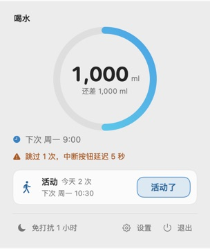
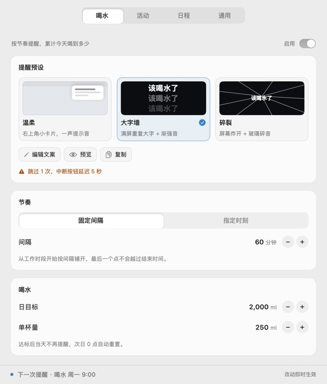
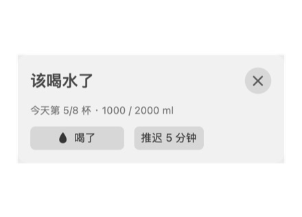

# Barge In

常驻 macOS 菜单栏的身体节律提醒，把提醒本身当产品做：平时不存在，该喝水、该起身活动、该进下一场会的时候，用一套能打断心流的提醒呈现把你从工作里拽出来。

零权限、零账号、零遥测。数据只在本机；日程是整个产品唯一可选的联网功能，只读。

官网：[barge-in.qiqiang.online](https://barge-in.qiqiang.online)

## 为什么做它

> "太温柔了。我知道我要喝水，但我就是停不下来工作。"

系统通知横幅、角标、轻轻一声"叮"——对"停不下来"的人等于零。现有提醒工具把"提醒长什么样"当成写死的功能，把"强制"藏进 JSON 开关。Barge In 的出发点是：**提醒的呈现方式就是产品**。

同一句"太温柔了"也适用于日程：日历 App 会在会前五分钟给你一条横幅，而你会把它划掉。Barge In 做的是**同一份日历，不同的打断强度**。

## 现在有什么（v0.2）

- 菜单栏常驻，无 Dock 图标、无主窗口
- **两个场景**：喝水（日目标、单杯量、今日进度、达标即静默）与活动（到点起身舒展，没有每日目标）；每个场景有自己的启用开关、调度、预设实例与账本
- 三种结束方式：**喝了 / 活动了**（或 1 秒内连按两次 Enter）/ **推迟 5 分钟** / **中断**（双击 Esc 或 ×，立刻生效，零等待）
- 两套呈现预设：温柔（右上角卡片 + 提示音）/ 大字墙（满屏重复大字 + 渐强音）；大字墙可选强度——标准（可推迟）/ 强硬（不可推迟、中断先锁 5 秒），出厂默认大字墙 · 标准，每张卡都能单独预览
- 违规账本按场景各一份：跳过越多越硬，完成一次回落，次日归零，且界面上会告诉你为什么
- **同时到点**：按提醒队列逐条呈现，关闭一条立刻下一条，提醒层显示"还有 N 个提醒"；每个场景最多一条，不静默丢弃
- 调度：固定间隔或每天指定时刻，可设工作时段与休息日（两个场景共用）；活动出厂默认每天 10:30 / 14:30 / 16:30
- 设置分四个 tab：喝水 / 活动 / 日程 / 通用；预设、节奏与启用开关按场景，工作时段、休息日与开机自启收在「通用」
- 免打扰 1 小时、开机自启
- **人不在就不提醒**：锁屏、屏幕睡眠、切到别的用户时不采集到点，离开时连正在显示的那条也收起；回来时日程仍按「开始后 10 分钟」补，节奏类等下一个点
- 首次启动一次预设选择同时应用到两个场景，随后立即真实预览一次

## v0.3 日程（设计中）

- 第三个场景：**订阅你已有的日历**，事件开始前 N 分钟（默认 5）把你拽出来
- 两种只读来源：**一条日历地址**（Google 秘密地址 / iCloud 公开共享 / Outlook 发布链接 / Nextcloud 公开分享），或**一套 CalDAV 凭据**（钉钉、企业微信、飞书、iCloud 私有、Fastmail、Nextcloud）
- 钉钉：日历设置 → 同步 → 同步到其他日历 → 获取 CalDAV 账号，把服务器、账号、密码填进来即可
- 只读的边界：只发读请求（`GET` / `PROPFIND` / `REPORT`），不写回、不新建、不删除、不读参会人；支持多条来源
- 日程豁免工作时段与休息日（19:00 的会、周六的日程照常提醒），免打扰仍然生效
- 两个会挨着也能各提醒一次，逐条呈现
- 拉取失败不丢提醒：按上次缓存继续提醒，并明说数据可能过期
- 出厂停用；添加订阅并成功拉取后提示开启

界面原型：[菜单栏](docs/prototypes/popover.html?preset=schederror) · [设置](docs/prototypes/settings.html?view=schedule)。支持范围与技术方案见 [设计](docs/design.md)，联网的边界见 [ADR-0001](docs/adr/0001-network-for-calendar-subscriptions.md)。

**关于联网**：日程是唯一会离开这台机器的功能。它只向你填的地址做只读请求（`GET` 取一条日历地址，`PROPFIND` / `REPORT` 取一个 CalDAV 账户），不上传任何内容，没有账号体系，没有遥测；关掉场景或删掉订阅就再也没有请求。

## 界面

| 菜单栏 | 设置 |
|---|---|
|  |  |

全屏提醒（标准档）：满屏重复的「该喝水了」，大小字混排、错峰闪烁。


跳过之后，中断按钮进入倒计时（"喝了"不受影响）：


温柔档：右上角卡片。



活动场景共用同一套呈现资源，只换文案与完成动作：


## 构建

需要 macOS 14 与 Command Line Tools（不需要完整 Xcode）。

```sh
git clone <repo>
cd BargeIn
make app          # 产出 "Barge In.app"（ad-hoc 签名）
open "Barge In.app"
```

开发时直接跑：

```sh
make run          # swift run
```

自检（不需要 UI）：

```sh
"./Barge In.app/Contents/MacOS/BargeIn" --selftest
```

离屏截图（`--snapshot <dir>`）会把 popover、设置和提醒层（含活动场景）渲染成 PNG，用于开发期视觉检查。

看一次提醒长什么样，不用等到点：

```sh
"./Barge In.app/Contents/MacOS/BargeIn" --demo
```

## 设计取舍

- **不劫持系统**：不拦键盘、不改系统音量、不阻止切 App。展示时短暂取得键盘焦点（双击 Esc 可中断），关闭后把前台还给原 App。强度来自"下次更硬"，不来自"这次逃不掉"
- **人不在就不提醒**：提醒是给正在工作的你，不是给空桌子。锁屏、屏幕睡眠、切走用户时到点的那一拍直接作废，账本也不记你跳过；回来时日程仍按「开始后 10 分钟」补，节奏类等下一个点
- **零系统权限**：不用通知中心、不用辅助功能、不用屏幕录制、不用 Apple Events。联网不是权限，它是产品对用户的一次性例外，写在这里而不是藏在设置里
- **覆盖层有最短生效延迟**：避免覆盖瞬间的点击误命中按钮
- **多场景不互相吞掉**：三个场景共用一套呈现资源，但各自调度、各自账本；同时到点逐条呈现。合并呈现与久坐检测留到用户真的需要时
- **日程只读**：Barge In 不排期、不改事件。它只回答"现在该停下了吗"，不回答"接下来该做什么"
- **开源 + 内容收费**：代码全公开、功能全开，将来收费的是预设（视觉做法、音效、文案）

## 文档

- [产品文档](docs/product.md)
- [产品路线图](docs/roadmap.md)
- [技术方案](docs/design.md)
- [竞品与市场调研](docs/competitor-scan.md)
- [术语表](GLOSSARY.md)
- 决策记录：[ADR-0001 日程订阅是唯一的联网功能](docs/adr/0001-network-for-calendar-subscriptions.md)

## License

MIT，见 [LICENSE](LICENSE)。
